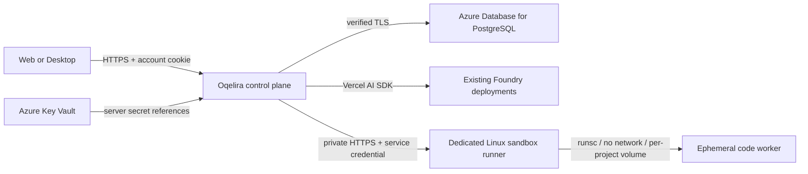

# Azure deployment target

This is the deployment runbook for the implemented multi-user server, not a
record of a completed Azure deployment. No resources have been created and no
cloud permissions have been changed. Subscription-specific identifiers belong
in private deployment configuration, not this public repository.

`foundation.bicep` defines a new VNet/subnets, runner network security rules,
private PostgreSQL, private Key Vault access/DNS and an ACR registry. It does not
deploy the API, runner host, app secrets or identities, and does not touch the
existing Foundry resource. The template was compiled with Bicep locally, and an
authenticated what-if succeeded against the selected existing resource group:
13 new resources and no modifications or deletions of existing resources.
France Central offers the starter Standard_B1ms Burstable SKU. Actual allocation
is still subject to Azure capacity and quota at deployment time.

Its required inputs are `location`, a reviewed `databaseSku`, and a secure
`databaseAdminPassword`. Supply secrets through private deployment tooling, not
literal shell arguments or checked-in parameter files. Review a what-if result
before applying the template to an existing resource group.
The optional `databaseTier` defaults to Burstable; choose GeneralPurpose with a
compatible SKU for a larger workload. The starter has no HA and fixed 32GB storage;
autogrow is enabled only for the GeneralPurpose branch of this template.

## Topology

Use a private PostgreSQL Flexible Server and an API subnet that can reach it.
The existing Foundry resource supplies inference; the application does not create
another Foundry agent or move its database into a Foundry project.

The API can be hosted on Azure Container Apps behind HTTPS. Keep one API replica
for this first deployment: approvals are routed to the process owning the stream.
Database leases are shared, but cross-replica approval routing is not implemented.
Do not mount Docker's socket into the public API container.

The private runner must be a separately administered Linux worker host with
gVisor, Docker, persistent project storage and disk quotas. Restrict its network
to the API subnet, terminate valid TLS before the loopback runner port, and store
the shared runner credential in Key Vault. Project containers must not reach
the metadata service, Foundry, PostgreSQL, Key Vault or other project volumes.
No networking is enabled inside the current worker containers.

## Inputs needed before a deployable Azure change can be reviewed

- Resource group and Azure region; confirm PostgreSQL and Container Apps support
  in that region and choose actual capacity and backup/retention settings.
- An authenticated Azure administrative session with the required scoped rights.
- Container registry and built API/worker images; pin worker images by digest.
- Public HTTPS application origin and private HTTPS runner address/certificate.
- Network/subnet, private DNS, runner storage/quota and sandbox runtime choices.
- Key Vault secret references for auth secret, database connection, Foundry key,
  and runner token. Do not paste their values into chat or command history.

Build the API image with `deploy/Dockerfile.server` and the worker with
`packages/worker/Dockerfile`. Run the database migration once as a controlled
deployment job with network access to the private database, then start the API.
Disable public sign-up. Establish account onboarding/recovery before opening
access beyond controlled test users. Run end-to-end isolation and restore tests
before exposing public registration or untrusted workloads.

## Production environment

| Variable | Source / purpose |
| --- | --- |
| `NODE_ENV` | `production` |
| `OQELIRA_SERVER_URL` | Public application HTTPS origin |
| `OQELIRA_AUTH_SECRET` | Random Key Vault secret, at least 32 bytes |
| `OQELIRA_DATABASE_URL` | Private PostgreSQL connection with `sslmode=verify-full` |
| `OQELIRA_ALLOW_SIGNUP` | `false` until controlled onboarding is ready |
| `FOUNDRY_ENDPOINT` or `FOUNDRY_BASE_URL` | Existing resource's model inference endpoint |
| `FOUNDRY_KEY` | Key Vault reference; never sent to clients/workers |
| `OQELIRA_MODELS_JSON` | Actual deployment IDs and supported API mode |
| `OQELIRA_RUNNER_URL` | Private runner HTTPS origin |
| `OQELIRA_RUNNER_TOKEN` | Random service credential from Key Vault |
| `OQELIRA_LISTEN_HOST` | `0.0.0.0` inside the API container only |
| `PORT` | `4320` |

Runner-specific configuration: `NODE_ENV=production`, `OQELIRA_CONTAINER_RUNTIME=runsc`,
`OQELIRA_WORKER_IMAGE=<registry/image>@sha256:<digest>` and the same runner token.
Keep its HTTP listener on loopback behind the private TLS proxy. The runner has
no Foundry or database credentials. Its host filesystem/daemon access is privileged
infrastructure and must never be exposed directly to users.

## Primary references

- [Private PostgreSQL networking](https://learn.microsoft.com/en-us/azure/postgresql/network/concepts-networking-private)
- [Container Apps resource configuration](https://learn.microsoft.com/en-us/azure/templates/microsoft.app/2024-03-01/containerapps)
- [Docker daemon and container security boundaries](https://docs.docker.com/engine/security/)
- [Better Auth database and migration support](https://better-auth.com/docs/concepts/database)
