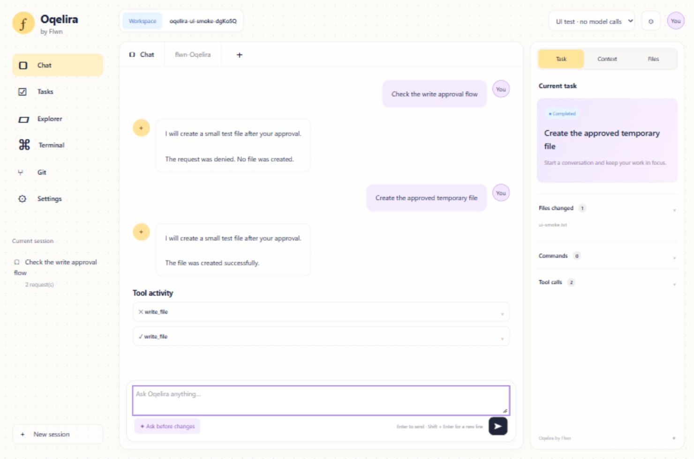

# Shared Web + Desktop architecture

## Current implementation

Both entry points use `@oqelira/ui` and the same browser-safe `@oqelira/protocol`.
The UI calls a same-origin HTTP host; it never imports core, Node filesystem APIs,
`ai`, or `@ai-sdk/*`. Vite produces a single renderer bundle.

`@oqelira/host` binds to `127.0.0.1`, serves the bundle, owns in-memory sessions,
and calls `runAgent` with the existing provider interface and built-in tools.
Provider adapters remain the only modules that import model SDKs. The CLI and host
share the restricted environment-file loader exported by core.

For Web, `npm run web` builds and starts the host on port 4317. For Desktop,
Electron starts a child host on a free port, receives its address over IPC, and
loads it in a sandboxed, context-isolated window. The child exits on IPC disconnect.
Electron disables Node integration and denies renderer navigation and new windows,
following [Electron security guidance](https://www.electronjs.org/docs/latest/tutorial/security).

## Transport

- `GET /api/config`: workspace display name, model deployment metadata and setup state.
- `POST /api/run`: prompt, configured model ID and optional server-issued session ID.
  The response is newline-delimited JSON: started, text, tool-call, approval,
  tool-result, done or error. Blank heartbeat lines keep waiting streams active.
- `POST /api/approval`: run ID, exact pending approval ID and boolean decision.
  Replayed, stale and mismatched decisions fail. No client-provided history or cwd
  is accepted. Sessions are capped at 100 and history size is bounded.

POST requests must carry the exact local Origin and `X-Oqelira-Client: workspace`.
The host validates Host, sends no permissive CORS headers, and serves a restrictive
Content Security Policy. Provider failures return generic messages instead of SDK
request bodies or headers. This is a local single-user boundary, not account auth.

Reads are allowed automatically. Writes and commands wait for a one-time decision;
no response after two minutes denies the operation. Disconnecting the response or
pressing Stop aborts the model request and denies the pending approval. Commands
remain powerful shell operations, so their full inputs are available for review.
Cancellation does not undo earlier approved writes or commands.

## State and current limits

Completed conversation history belongs to the host. The renderer tracks visible
messages, tool results and successful file-tool paths. Refresh/New session starts
a fresh conversation; there is no durable session store. Failed or interrupted UI
runs do not silently reuse previous host history. File activity is not a Git diff.

The runtime still uses the existing core tools and permission boundary; it is not
an operating-system workspace sandbox. A user-approved command can access outside
the project. Flwn memory and auth remain deferred behind a future gateway.

## Next implementation tasks

1. Read-only Explorer and file viewer with workspace path checks and secret-file filtering.
2. Git status and actual diffs; reviewed apply/revert actions with separate permissions.
3. Persist sessions and partial execution history, with resume/reconnect and context limits.
4. Refine the pastel UI against the reference, including icons, code rendering and diff cards.
5. Add a workspace picker and desktop packaging after the connected flow is stable.

## Validation

`npm run typecheck`, `npm test`, `npm run build`, and the desktop syntax check.
Host tests use a mock provider and temporary workspaces to verify streaming,
server-owned history, actual file reads, approval/denial, stale and replayed
approvals, expiry, concurrent-run rejection, disconnect cleanup and safe errors.
Manual browser checks exercise denial and approval across turns with repeated
tool IDs. These tests do not contact Foundry or prove live-model behavior.

