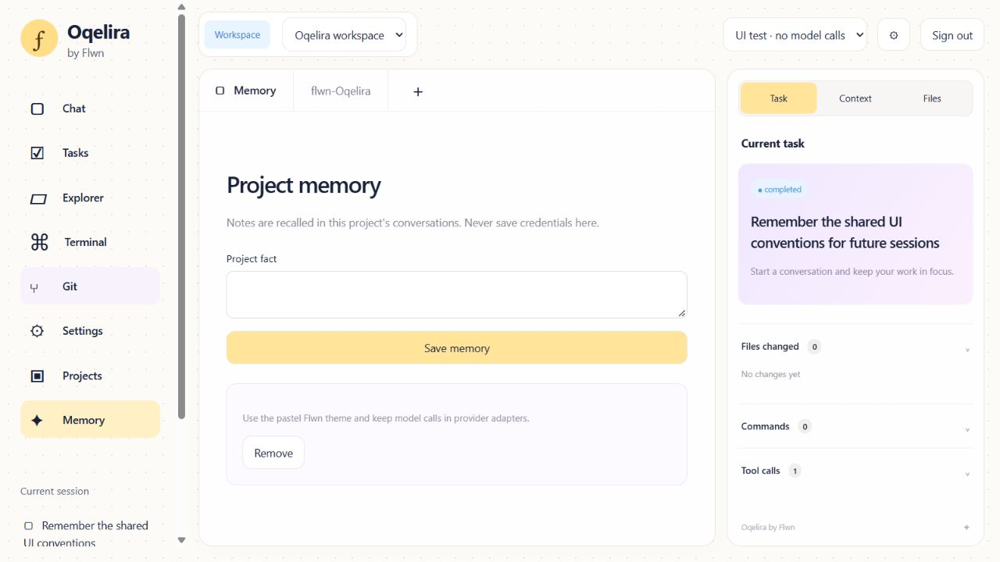

# Multi-user Oqelira server

The standalone multi-user mode lives in `packages/server`. The existing local
host and CLI remain available. This server is implemented and tested locally;
it has not been deployed to Azure or validated with a running Docker engine.

## Connected functionality

- Better Auth email/password accounts and database-backed login sessions.
- PostgreSQL projects, conversations, checkpoints, project notes, audit decisions
  and request/run quota counters. Every business query is scoped to the signed-in
  user; projects are private to their owner in this version, not shared team workspaces.
- Streaming agent runs over the existing Vercel AI SDK Foundry adapter. Deployment
  names come from `OQELIRA_MODELS_JSON` or the existing configured default registry.
- Saved conversation selection after reload. Partial tool histories are repaired
  with explicit unknown outcomes; an interrupted operation is never auto-replayed.
- Project notes are recalled into future prompts, capped at 20 recent notes / 12000
  characters. This is explicit factual memory, not embeddings or semantic retrieval.
  The agent needs approval to save a note. Users can also save/remove notes in Memory.
- Explorer list/read/save and a fixed read-only Git status/diff endpoint. A new
  project starts empty. Files can be authored in Explorer or by approved tools.
- One running operation per project using database leases; writes and commands
  from the model require a one-time approval tied to user, login session and run.
- Dedicated sandbox runner transport. The control plane never gives a browser
  filesystem APIs, a Docker socket, database credentials or a Foundry key.

## Local multi-user development

Use Node 24 LTS and a working Docker Desktop Linux engine. From the repository root:

```powershell
npm install
npm run setup:server
npm run db:start
npm run db:migrate
npm run worker:build
npm run build
```

Then keep these running in separate terminals:

```powershell
npm run sandbox
npm run server
```

Open `http://127.0.0.1:4320`, create a development account, and create a project.
`setup:server` creates ignored `.env.server` with random secrets and copies only
the known Foundry settings from the existing configuration. It never overwrites
an existing file or prints its contents. Development sign-up is enabled there.

Check the actual provider independently with `npm run foundry:check`. It sends one
short prompt without project code and reports success without echoing headers,
keys, endpoint URLs or model response text.

To connect Desktop to the same server, set only its server URL:

```powershell
$env:OQELIRA_DESKTOP_SERVER_URL='http://127.0.0.1:4320'
npm run desktop
```

Use an HTTPS URL for a remote server. Do not copy server-side secrets or the
server environment file onto client machines.

## Security boundaries and limits

Production requires an HTTPS application origin, verified PostgreSQL TLS
(`sslmode=verify-full`), and a private HTTPS runner. The production runner requires
gVisor's `runsc` runtime and a digest-pinned image. Missing configuration fails
startup; there is no fallback to executing project commands on the API server.

Workers run as UID 1000, without network access, host bind mounts, Linux capabilities
or writable root filesystems. Each project has a separate named volume. CPU, memory,
PID, output and time limits are applied. Killing a request also requests container
removal. Credential paths and symlink escapes are blocked by file tools. Shell
commands are deliberately powerful *inside the project sandbox* and always need
approval. Approved commands can modify project files, including Git metadata.

API requests enforce Host and Origin; auth cookies are HttpOnly and Secure in
production. Better Auth handles password hashing, login sessions, CSRF and login
rate limiting. API quotas are 120 requests/minute and 10 runs/hour per account;
runs are capped at 25 model steps, 4000 output tokens/step and 10 minutes. These
are initial defaults, not a complete billing or tenant-resource accounting system.

The local development Docker runner is not a production isolation proof. Disk
quotas, idle workspace reclamation, resource monitoring, runner recovery, container
escape testing and backup/restore drills must be completed on the target platform.
No server/Foundry secrets are passed into a worker. Do not put secrets in project
notes or upload sensitive environment files.

## Validation and known unfinished work

The automated suite exercises real Better Auth flows and a real PostgreSQL engine
through PGlite (the test pg transport is adapted), including two users, cross-user
read/write rejection, approval ownership, logout revocation, project leases,
quotas and persistence after closing/reopening the database. Worker file tests
exercise actual file operations in temporary directories. They do not prove
Docker or gVisor isolation on Azure.

Manual browser checks cover account creation, creating a project, approval of
project memory, and reopening a saved conversation after refresh. One real
Foundry deployment was verified through the provider. The end-to-end combination
of Azure PostgreSQL + private runner + live Foundry has not been tested yet.

Remaining product work includes Flwn SSO, Desktop external-browser OAuth return,
repository import and GitHub repository credentials, semantic memory/retrieval,
cross-process job recovery, billing and signed desktop releases. Account email
and Google/GitHub activation require actual sender/provider configuration and
live callback validation. Production signup stays closed pending deployment
isolation validation. No claim of production completeness or penetration testing
is made.



See [Azure deployment boundaries](../deploy/azure/README.md).

## Code search and reliable completion

The shared `search_text` read tool is available to CLI, local Web/Desktop and the
isolated server worker. It searches literal text, returning project-relative
paths, 1-based line numbers and snippets. It needs no shell approval or additional
network access. Its runtime engine is shared with the standalone worker and is
checked by TypeScript using `checkJs`; the agent adapter remains TypeScript.

Search skips hidden paths (including `.env` and `.git`), key/certificate files,
common dependency/build directories, symlinks, binary files and files above
256 KB. Defaults: 100 matches; hard limits: 200 matches, 2,000 visited entries,
8 MB scanned, five seconds and a bounded JSON response. Results explicitly report
limits; narrow the query/path to continue. This is not a full `.gitignore` parser
or a guarantee that arbitrary source files contain no secrets.

An errored or unfinished model stream no longer becomes a completed task. Tool
calls returned at the model output limit are recorded as not executed, preserving
valid conversation history without applying a partial change. Review incomplete
output before continuing. The worker image must be rebuilt to include search.

## Production registration gate

Production startup rejects `OQELIRA_ALLOW_SIGNUP=true` while deployment isolation
and live identity delivery remain unvalidated. Local signup remains available
for development fixtures. Configure account mail and identity providers using
the optional settings in `.env.example`; never commit their credentials.

The Teams view creates verified-user organizations and sends invitations through
the mail outbox. Owner/admin manage members and shared projects; members can run
the agent; viewers can read without starting runs, writing or approving tools.
Each endpoint checks current membership. Public signup is not enabled by adding
an OAuth provider. Identity linking is explicit in Settings; matching email alone
does not merge accounts.

Server runs requested by the Web/Desktop client retain sequenced events in
PostgreSQL. A dropped stream reconnects without repeating tools; Stop explicitly
cancels the run. This supports one API process. Stored events survive restart,
but an interrupted process does not automatically replay or resume commands.

Context compaction builds a bounded, lossy request view while retaining the full
transcript. Tracked UTF-8 text changes up to 10000 characters use snapshot hashes,
fresh write approvals and ignored `.oqelira/changes` records. Revert rejects newer
edits. Legacy writes and arbitrary shell commands are not automatically reversible.
